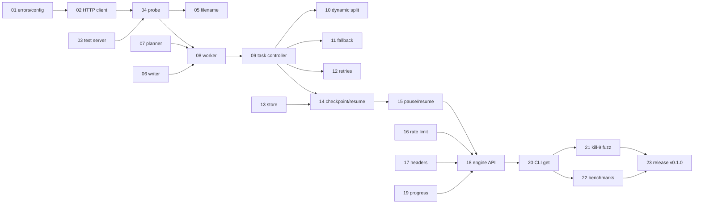

# Backlog

Requirement IDs (`ENG-03`, `UI-02`, ...) refer to [PRD.md](PRD.md). Milestones refer to [ROADMAP.md](ROADMAP.md).

## Conventions

| Field | Meaning |
|---|---|
| **ID** | `M<milestone>-<nn>`. Used in branch names (`feat/m1-07-segment-planner`) and PR titles (`feat(core): segment planner (M1-07)`). |
| **Size** | **S** up to half a day, **M** 1–2 days, **L** 3–5 days. Anything bigger is split. |
| **Deps** | Tasks that must be merged first. |
| **Done when** | Acceptance criteria. A task is not done until all of them pass in CI. |

**Definition of Done (every task)**
- Code, tests and docs in one PR; CI green on Windows, macOS and Linux.
- `cargo clippy -D warnings` and `pnpm lint` clean; no `unwrap()` in library code.
- Public Rust items documented. The changelog is generated from PR titles by git-cliff at release time, so write a clear Conventional Commit PR title; don't edit `CHANGELOG.md` by hand.
- Design docs updated if behaviour differs from them.
- The task's line in [ROADMAP.md](ROADMAP.md) is ticked in the same PR, so progress on `main` is always accurate.

**Order of work:** tasks are listed in the recommended order. Tasks without a dependency on each other can run in parallel.

---

## M0 — Foundation

Goal: every part of the monorepo exists, builds and is tested in CI, even if it does nothing yet.

| ID | Task | Size | Deps | Reqs |
|---|---|---|---|---|
| M0-01 | Cargo workspace + `loeun-core` library stub | S | — | — |
| M0-02 | `loeun-cli` binary stub | S | M0-01 | API-01 |
| M0-03 | pnpm workspace + Biome | S | — | — |
| M0-04 | Tauri 2 + React + TypeScript desktop shell | M | M0-01, M0-03 | — |
| M0-05 | Browser extension skeleton (Chrome + Firefox builds) | M | M0-03 | BRW-01 |
| M0-06 | `loeun-native-host` binary stub | S | M0-01 | BRW-05 |
| M0-07 | Repo scripts: `render-assets`, `bump-version` | S | M0-04, M0-05 | — |
| M0-08 | GitHub setup: labels, milestones, branch protection, issues from this backlog | S | — | — |

**M0-01 Cargo workspace + `loeun-core` stub**
- Root `Cargo.toml` with `[workspace]`, `resolver = "3"`, shared `[workspace.package]` (version, edition 2024, license, repository, `rust-version` = 1.96) and `[workspace.lints]` (deny `unsafe_code` by default, warn `clippy::pedantic` selectively).
- `crates/loeun-core` with `lib.rs` exposing `pub fn version() -> &'static str` and one unit test.
- Commit `Cargo.lock`.
- *Done when:* `cargo build`, `cargo nextest run`, `cargo clippy`, `cargo deny check` pass locally and the CI rust jobs run (not skip) green on all three OSes.

**M0-02 `loeun-cli` stub**
- `crates/loeun-cli`, binary name `loeun`, `clap` derive with `--version` and an empty `get` subcommand that prints "not implemented".
- *Done when:* `cargo run -p loeun-cli -- --version` prints the workspace version; release workflow's CLI job can build it.

**M0-03 pnpm workspace + Biome**
- Root `package.json` (`"private": true`, `packageManager: pnpm@<pinned>`), `pnpm-workspace.yaml` (`apps/*`, `extension`), `biome.json`, root scripts `lint`, `format`, `typecheck`, `test`.
- *Done when:* `pnpm install && pnpm lint` passes; CI node job runs green.

**M0-04 Tauri desktop shell**
- `apps/desktop` (Tauri 2, React + TS + Vite), product name `Loeun`, identifier `io.github.touchde.loeun` (we do not own a domain; reverse-DNS of the GitHub Pages host keeps the identifier stable).
- Depends on `loeun-core` and shows its version in the window.
- Icons generated with `tauri icon` from `assets/app-icon/` (see BRAND.md); Tailwind CSS set up with brand tokens.
- Strict CSP and minimal capabilities file.
- *Done when:* `pnpm --filter desktop tauri dev` opens a window on macOS; CI desktop-build job is green on all three OSes.

**M0-05 Extension skeleton**
- `extension/` with Vite build producing `dist/chrome` and `dist/firefox` from `manifest.chrome.json` / `manifest.firefox.json`; MV3 service worker that logs on install; popup showing "Loeun"; icons from `assets/extension/`.
- Vitest set up with a mocked `chrome` global.
- *Done when:* both builds load unpacked in Chrome and Firefox without errors; `pnpm --filter extension test` passes in CI.

**M0-06 Native host stub**
- `crates/loeun-native-host`: reads one length-prefixed JSON message from stdin, replies `{"type":"result","ok":true}` to `hello`.
- *Done when:* a unit test round-trips the framing; binary builds on all OSes.

**M0-07 Repo scripts**
- `scripts/render-assets` regenerates all PNGs from SVGs (see BRAND.md); `scripts/bump-version X.Y.Z` updates Cargo, `package.json` and `tauri.conf.json` together.
- *Done when:* running `bump-version 0.0.1` changes exactly those files; documented in RELEASE.md.

**M0-08 GitHub setup**
- Labels: `type:*`, `area:core|cli|desktop|ext|host|ci|docs`, `good first issue`, `help wanted`, `needs-triage`, `size:S|M|L`.
- Milestones M0–M5; one issue per task in this file; branch protection on `main` requiring "CI success"; squash-merge only; Discussions and private vulnerability reporting enabled.
- *Done when:* every task in M0 and M1 has an issue linked to its milestone.

---

## M1 — Core engine + CLI (v0.1.0)

Goal: `loeun get <url>` downloads faster than a single-connection download, survives `kill -9`, and resumes correctly.

| ID | Task | Size | Deps | Reqs |
|---|---|---|---|---|
| M1-01 | Error types and config model | S | M0-01 | — |
| M1-02 | HTTP client factory | S | M1-01 | ENG-01 |
| M1-03 | Fault-injection test server | M | M0-01 | — |
| M1-04 | Probe | M | M1-02, M1-03 | ENG-01, ENG-05 |
| M1-05 | Filename resolution and sanitization | M | M1-04 | ENG-11 |
| M1-06 | File writer (preallocate + positional writes) | M | M1-01 | ENG-09 |
| M1-07 | Segment planner | S | M0-01 | ENG-02 |
| M1-08 | Segment worker | M | M1-04, M1-06, M1-07 | ENG-02 |
| M1-09 | Task controller (multi-connection download end to end) | M | M1-08 | ENG-02 |
| M1-10 | Dynamic segment splitting | M | M1-09 | ENG-03 |
| M1-11 | Single-connection fallback and unknown length | S | M1-09 | ENG-05 |
| M1-12 | Retries, backoff, error classification | M | M1-09 | ENG-08 |
| M1-13 | SQLite store and migrations | M | M1-01 | ENG-07 |
| M1-14 | Checkpointing and crash-safe resume | L | M1-09, M1-13 | ENG-07 |
| M1-15 | Task state machine: pause, resume, cancel | M | M1-14 | ENG-06 |
| M1-16 | Hierarchical rate limiter | M | M1-01 | ENG-10 |
| M1-17 | Custom headers, cookies, referer, user agent | S | M1-02 | ENG-12 |
| M1-18 | Engine public API, event bus, concurrent-download limit | M | M1-15, M1-16, M1-17, M1-19 | QUE-01 |
| M1-19 | Progress, speed and ETA reporting | S | M1-09 | UI-01 (data) |
| M1-20 | `loeun get` CLI | M | M1-18 | API-01 |
| M1-21 | Kill-9 crash fuzz test | M | M1-20 | NFR durability |
| M1-22 | Benchmark harness and BENCHMARKS.md | M | M1-20 | NFR throughput |
| M1-23 | Release v0.1.0 | S | M1-21, M1-22 | — |

**M1-01 Error types and config model**
- `Error` enum with `thiserror` covering network, HTTP status, IO, disk full, validation, cancelled; `ErrorKind::is_retryable()`.
- `EngineConfig` with defaults from the PRD (8 connections, 1 MiB min segment, 3 concurrent downloads, retries 5).
- *Done when:* unit tests cover defaults and `is_retryable` for every variant.

**M1-02 HTTP client factory**
- `reqwest` with `rustls` + platform verifier, HTTP/2 enabled, connect/read timeouts, redirect limit 10, compression disabled (ranged bytes must be raw), default UA `Loeun/<version>`.
- *Done when:* a test against the local test server confirms HTTP/2 over TLS and that `Accept-Encoding` is not sent.

**M1-03 Fault-injection test server**
- `tests/support` crate (`loeun-testserver`, dev-only) with `axum`, serving deterministic random files and toggles per request: range on/off, per-connection throttle, reset after N bytes, ETag change, 429 + `Retry-After`, redirect chain, chunked without length, `Content-Disposition` variants, slow first byte.
- *Done when:* each scenario has a smoke test; server starts on an ephemeral port in under 50 ms.

**M1-04 Probe**
- `GET` with `Range: bytes=0-0`; follow redirects; record original and final URL; parse `Content-Range`, `Content-Length`, `Accept-Ranges`, `ETag`, `Last-Modified`, `Content-Type`.
- Output `ProbeResult { size: Option<u64>, resumable: bool, validators, final_url, mime, disposition }`.
- *Done when:* tests cover 206, 200-with-length, chunked, `Accept-Ranges: none`, redirects, and servers that ignore `Range`.

**M1-05 Filename resolution and sanitization**
- Priority: user name, then `Content-Disposition` (`filename*` RFC 5987 first), then URL path (percent-decoded), then `download`. Add an extension from MIME when missing.
- Sanitize: strip path separators and `..`, control characters, Windows reserved names (`CON`, `NUL`, ...) and trailing dots/spaces; cap at 255 bytes keeping the extension.
- Collision helper: `name (1).ext`, `name (2).ext`.
- *Done when:* table tests for 30+ real-world headers; proptest that output never contains a path separator.

**M1-06 File writer**
- Create `<name>.loeun-part`, preallocate (`fallocate` / `F_PREALLOCATE` / `set_len`), write `(offset, Bytes)` from a bounded channel with positional I/O on a blocking thread, `flush_durable()` = `fdatasync`.
- *Done when:* concurrent writes from 16 tasks produce a byte-identical file; disk-full is surfaced as `Error::DiskFull` (tested with a small tmpfs on Linux CI).

**M1-07 Segment planner**
- Pure function: `plan(size, connections, min_segment) -> Vec<Segment>`; `split(&Segment) -> Option<(Segment, Segment)>` aligned to 64 KiB.
- *Done when:* proptests prove segments are contiguous, non-overlapping and cover `[0, size)` exactly.

**M1-08 Segment worker**
- Ranged `GET` with `If-Range`; streams chunks to the writer; updates an `AtomicU64` progress counter; stops at the atomic `end` (supports being shortened mid-flight); verifies 206 and `Content-Range`.
- *Done when:* tests download a single segment correctly, and stop exactly at a shortened end.

**M1-09 Task controller**
- Probes, plans, spawns C workers, waits for completion, flushes, renames `.loeun-part` to the final name.
- *Done when:* a 256 MiB file from the test server downloads with 8 connections and its SHA-256 matches; with per-connection throttling, 8 connections are at least 6x faster than 1.

**M1-10 Dynamic segment splitting**
- When a worker finishes, split the largest remaining segment and reuse the worker (see ENGINE_DESIGN §4).
- *Done when:* with one artificially slow segment, total time is within 15% of the ideal; no byte is downloaded twice beyond one chunk per split (asserted via server byte counters).

**M1-11 Single-connection fallback and unknown length**
- Non-resumable servers use one worker; unknown length streams to the end; the task is marked non-resumable.
- *Done when:* tests cover 200-only servers and chunked responses.

**M1-12 Retries, backoff, error classification**
- Per-segment retry with exponential backoff and jitter, `Retry-After` honoured, max retries from config; 401/403/410 mark the task `needs_refresh`; disk full pauses the task.
- *Done when:* the download completes with random connection resets every 5 MiB; 429 responses wait at least the `Retry-After` time.

**M1-13 SQLite store and migrations**
- Schema from ENGINE_DESIGN §7, `rusqlite` bundled, WAL, embedded migrations, async wrapper on a dedicated thread; CRUD for tasks, segments and settings.
- *Done when:* migration from an empty DB is tested; concurrent reads during writes don't block.

**M1-14 Checkpointing and crash-safe resume**
- Every 2 s or 8 MiB: `fdatasync` then commit offsets in one transaction. On resume: re-probe, compare validators, continue or restart according to ENGINE_DESIGN §6.
- *Done when:* tests resume after a simulated crash at 10 random points with a matching SHA-256; ETag change triggers restart.

**M1-15 Task state machine**
- States and transitions from ENGINE_DESIGN §1; pause stops workers after the current chunk and checkpoints; cancel deletes the part file; startup moves interrupted tasks to *Paused*.
- *Done when:* every transition is covered by a test, and illegal transitions return an error.

**M1-16 Hierarchical rate limiter**
- Token buckets for global and per-task (queue level later), refilled every 50 ms, adjustable at runtime.
- *Done when:* a 2 MB/s limit holds within ±5% over 10 s; changing the limit takes effect within 200 ms.

**M1-17 Custom headers, cookies, referer, user agent**
- `AddRequest` carries headers and a cookie string; values are applied to probe and every worker; cookies never logged.
- *Done when:* the test server sees the exact headers on all connections; a log-capture test finds no cookie values.

**M1-18 Engine public API and event bus**
- `Engine::builder()`, `add`, `pause`, `resume`, `cancel`, `remove`, `list`, `get`, `subscribe`; manager actor with a max-concurrent limit and FIFO queue; typed `Event` enum.
- *Done when:* an integration test adds 5 downloads with limit 2 and sees at most 2 active at once; API docs build with examples.

**M1-19 Progress, speed and ETA**
- Sample counters every 250 ms; EWMA speed over about 3 s; ETA; throttled `TaskProgress` events (4 Hz) including per-segment ranges.
- *Done when:* unit tests on the EWMA with synthetic samples; events never exceed the throttle rate.

**M1-20 `loeun get` CLI**
- `loeun get <url> [-o PATH] [-c N] [--limit RATE] [-H "K: V"] [--cookie STR]`, progress bar with segments, speed and ETA; Ctrl-C pauses and saves state; running the same command again resumes.
- `loeun list` / `loeun resume <id>` for stored tasks.
- *Done when:* manual check against three public mirrors on three OSes; snapshot tests for `--help`.

**M1-21 Kill-9 crash fuzz test**
- Spawn `loeun get`, `SIGKILL` (or `TerminateProcess` on Windows) at random times, resume, compare SHA-256. Short run on PRs, long run nightly.
- *Done when:* 200 iterations pass with zero corruption; nightly workflow added.

**M1-22 Benchmark harness**
- Compare Loeun vs `curl` and `aria2c` at equal connection counts against the local throttled server and two public mirrors; output a Markdown table to `docs/BENCHMARKS.md`.
- *Done when:* Loeun matches or beats aria2 on the local server; results committed.

**M1-23 Release v0.1.0**
- Bump version, tag, verify the release workflow publishes CLI binaries for all six targets and SHA256SUMS.
- *Done when:* a draft release exists with all assets and has been smoke-tested on macOS, Windows and Linux.

---

## M2 — Desktop app (v0.2.0)

| ID | Task | Size | Reqs |
|---|---|---|---|
| M2-01 | Embed `Engine` in Tauri state; forward events; typed bindings with `tauri-specta` | M | — |
| M2-02 | Single instance, window state, start at login, start minimized | S | UI-12 |
| M2-03 | System tray / menu bar with global speed and quick actions | M | UI-04 |
| M2-04 | App layout, theme tokens, light/dark following the OS | M | UI-06 |
| M2-05 | Download list (virtualized), status pills, row actions | L | UI-01 |
| M2-06 | Search and filters (status, category, text) | S | UI-07 |
| M2-07 | Detail panel: segment progress bar and live speed graph (uPlot) | M | UI-02 |
| M2-08 | New download dialog with clipboard prefill | M | UI-03 |
| M2-09 | Duplicate detection prompt (rename / overwrite / skip) | S | QUE-07 |
| M2-10 | Categories with per-category folders | M | QUE-05 |
| M2-11 | Settings screen (folders, connections, concurrency, speed limit) | M | SET-01 |
| M2-12 | Desktop notifications on complete / fail | S | UI-05 |
| M2-13 | "Link expired" and error states with clear fixes | S | ENG-15 (UI) |
| M2-14 | Installers: MSI/NSIS, DMG, AppImage/deb/rpm; release dry run | M | — |
| M2-15 | Release v0.2.0 | S | — |

## M3 — Browser integration (v0.3.0)

| ID | Task | Size | Reqs |
|---|---|---|---|
| M3-01 | Native messaging protocol + JSON schema validation in the host | M | BRW-05 |
| M3-02 | Local IPC server in the app (named pipe / Unix socket); host relays to it; launches app if not running | M | BRW-05 |
| M3-03 | Host manifest registration for Chrome, Edge, Brave, Firefox on all OSes; "Repair" button | M | BRW-05 |
| M3-04 | Download capture rules (type, size, bypass key, site deny list) | M | BRW-02 |
| M3-05 | Cookie, referer, UA forwarding (incl. partitioned cookies) | S | BRW-04 |
| M3-06 | Context menus: link, all links, selection | S | BRW-03 |
| M3-07 | Popup (status, toggle) and options page | M | BRW-01 |
| M3-08 | Fallback: restore browser download if the app is unavailable | S | BRW-02 |
| M3-09 | Store listings and submission (Chrome, Edge, AMO) + publish workflow | M | BRW-01 |
| M3-10 | Release v0.3.0 | S | — |

## M4 — Power features (v0.4 – v0.9)

Broken into tasks when M3 is done. Grouped as releases:

| Release | Scope | Reqs |
|---|---|---|
| v0.4 | Adaptive connections, per-host caps, proxies, auth + keychain | ENG-04, ENG-13, ENG-14 |
| v0.5 | Link refresh, checksums, mirrors | ENG-15, ENG-16, ENG-17 |
| v0.6 | Multiple queues, scheduler, post-download actions, category rules | QUE-02, QUE-03, QUE-04, QUE-06 |
| v0.7 | HLS/DASH download, media sniffer | ENG-20, BRW-06 |
| v0.8 | Daemon + JSON-RPC, deep links, batch patterns, import/export | API-02, API-03, API-05, QUE-08, QUE-09 |
| v0.9 | i18n (English, Khmer), shortcuts, accessibility, clipboard monitor, site rules, portable mode, settings import/export | UI-08..10, BRW-07, BRW-09, SET-02, SET-03 |

## M5 — v1.0.0

| ID | Task | Reqs |
|---|---|---|
| M5-01 | macOS signing + notarization in CI | — |
| M5-02 | Windows code signing (Azure Trusted Signing or SignPath) | — |
| M5-03 | Signed auto-update with stable and beta channels | SET-04 |
| M5-04 | NFR verification: throughput, CPU, memory, startup, installer size | PRD §7 |
| M5-05 | Security review: IPC, native host, filename handling, webview capabilities | — |
| M5-06 | User documentation site (guide, FAQ, CLI reference) | — |
| M5-07 | Release v1.0.0 | — |
